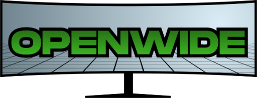
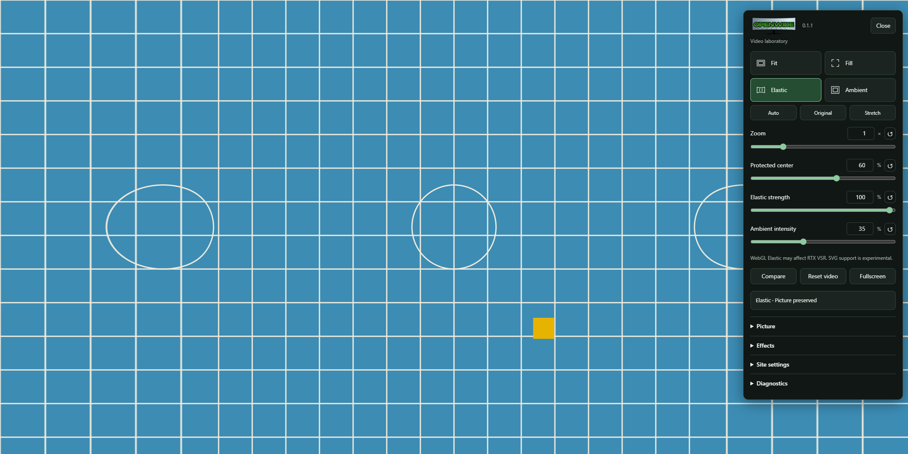
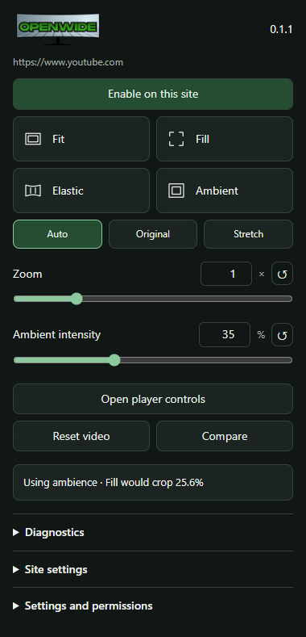
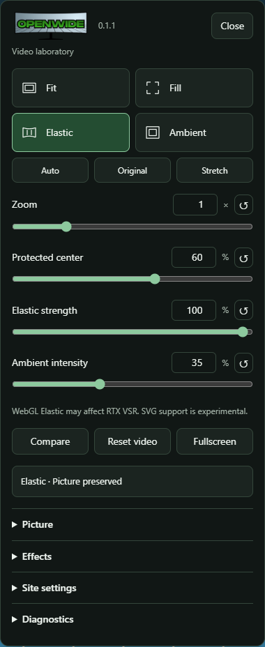

<div align="center">



# Openwide

### Fit, stretch, and light your videos for an ultrawide screen.

Openwide is a free, open source Chrome and Edge extension that removes encoded black padding, fits video to your display, and fills unused space with center-preserving elastic stretch or soft ambient light. Playback stays in the site's original video player.

<p>
  <a href="https://github.com/sudoaanish/Openwide/releases/tag/v0.1.1">
    
  </a>
  <a href="https://github.com/sudoaanish/Openwide/releases">
    
  </a>
  <a href="LICENSE">
    
  </a>
</p>

<p>
  
  
  
</p>

<p>
  <a href="#preview">Preview</a> ·
  <a href="#features">Features</a> ·
  <a href="#installation">Install</a> ·
  <a href="#compatibility">Compatibility</a> ·
  <a href="#development">Development</a>
</p>

</div>

---

## Preview

<p align="center">
  
</p>

| Extension popup                                                                                                  | Elastic controls                                                                                            |
| ---------------------------------------------------------------------------------------------------------------- | ----------------------------------------------------------------------------------------------------------- |
|  |  |

## Why Openwide?

A widescreen film can arrive inside a 16:9 video frame, leaving encoded bars above and below the picture and player-created bars on either side. Openwide identifies the active picture before fitting it to the available screen.

For video that would lose too much picture when zoomed, Auto keeps its proportions and uses ambience. Elastic offers a separate option: preserve the center's horizontal scale and expand the edges smoothly.

## Features

- **Seven display modes:** Auto, Original, Fit, Fill, Stretch, Elastic, and Ambient.
- **Conservative Auto fitting:** remove confidently detected black padding, then Fill only when estimated picture loss stays within the crop budget. The default is 2%.
- **Elastic Stretch:** adjustable protected center and strength, continuous horizontal mapping, and a maximum local edge expansion of 2×.
- **Fullscreen ambience:** blurred colors from the active picture behind the original video, with brightness, blur, spread, smoothing, and quality controls.
- **Picture adjustments:** zoom, pan, aspect presets, custom ratios, manual borders, detection lock, rotation, and flips.
- **Playback and effects:** speed from 0.25×–4× where supported, plus brightness, contrast, and saturation.
- **YouTube controls:** Fill, Elastic, and Openwide settings buttons inside the native player control bar.
- **Site profiles:** save settings per origin, disable individual sites, and import/export settings locally.
- **Accessible controls:** keyboard mode selection, editable values, individual resets, held comparison, and visible focus.

## Installation

Openwide 0.1.1 is distributed as an unpacked extension. Node.js is not required to use a release ZIP.

1. Download **`openwide-0.1.1.zip`** from [Releases](https://github.com/sudoaanish/Openwide/releases).
2. Extract it into a permanent folder.
3. Open `chrome://extensions` in Chrome or `edge://extensions` in Edge.
4. Turn on **Developer mode**, choose **Load unpacked**, and select the extracted folder containing `manifest.json`.
5. Open a video page, click the Openwide extension icon, and choose **Enable on this site**.
6. Play the video and select a mode. Use **Open player controls** for the full panel.

Embedded players can require permission for their own origin. The popup includes an embedded-origin permission control.

To update, replace the files in the same installation folder, click **Reload** on the existing extension card, and reload the video page. Keeping the same installation preserves the extension identity, profiles, permissions, and shortcut assignments.

See [installation and troubleshooting](docs/INSTALLATION.md) for detailed instructions.

## Controls

| Shortcut      | Action                               |
| ------------- | ------------------------------------ |
| `Alt+Shift+U` | Toggle the player panel              |
| `Alt+Shift+M` | Cycle Fit → Fill → Elastic → Ambient |
| `Alt+Shift+R` | Reset the current video              |

Shortcuts can be reassigned through the browser's extension shortcut settings. Playback shortcuts are ignored while editing controls. Hold **Compare** to view the original presentation.

## Compatibility

Chrome and Edge are tested on Windows. Chrome 116 or newer is required. Player compatibility and available effects are listed below.

| Player                  | Verification                                                               | Effects                                                                                      |
| ----------------------- | -------------------------------------------------------------------------- | -------------------------------------------------------------------------------------------- |
| YouTube                 | Live Chrome fitting, padding removal, ambience, and WebGL Elastic verified | Available when video pixels are readable                                                     |
| Jellyfin Web / Plex Web | Adapters included; service-level validation incomplete                     | Determined at runtime                                                                        |
| Netflix / Hulu          | Adapters included; service-level validation incomplete                     | Protected playback keeps native fitting and manual adjustments where the player permits them |
| Generic HTML video      | Controlled Chrome/Edge fixtures verified                                   | Determined at runtime                                                                        |

Dynamic detection, ambience, and WebGL Elastic require readable pixels. Protected playback uses native fitting and manual border controls. SVG Elastic is experimental; protected-playback support is unverified.

Original, Fit, Fill, Auto, Stretch, and Ambient retain native foreground video. RTX Video Super Resolution is managed by the browser and NVIDIA driver; Openwide neither enables nor detects it. WebGL Elastic can affect VSR compatibility.

Firefox, picture-in-picture effects, native media players, and local-file playback are outside this release. See the [capability matrix](docs/COMPATIBILITY.md).

## Privacy

Video processing runs locally on your device. Settings remain in extension-local browser storage, and content scripts run only on origins granted through the popup. Settings exports contain preferences and configured site origins. Video frames and viewing history are not collected.

See [privacy and permissions](PRIVACY.md) for the permission breakdown.

## Development

### Requirements

- Node.js 22.12 or newer and npm
- Chromium for browser tests; installed Chrome or Edge for browser-specific checks

```bash
git clone https://github.com/sudoaanish/Openwide.git
cd Openwide
npm ci
npm run dev
```

Open the development server URL to use the generated video fixture. Build the extension and load `dist` to test real Manifest V3 behavior:

```bash
npm run typecheck
npm test
npm run build
npx playwright install chromium
npm run test:browser
```

Create the unpacked release archive and SHA-256 checksum:

```bash
npm run package
```

Output: `release/openwide-0.1.1.zip` and `release/SHA256SUMS.txt`.

The extension uses TypeScript, Vite, Manifest V3, Shadow DOM, WebGL2, Vitest, and Playwright. Runtime assets are packaged locally. See [architecture](docs/ARCHITECTURE.md), [testing](docs/TESTING.md), and [contributing](CONTRIBUTING.md).

## License

Openwide is licensed under the [MIT License](LICENSE).

Created by **Aanish Farrukh** / [sudoaanish](https://github.com/sudoaanish).

<p>
  <a href="https://github.com/sudoaanish">
    
  </a>
  <a href="https://aanishfarrukh.com/">
    
  </a>
</p>
